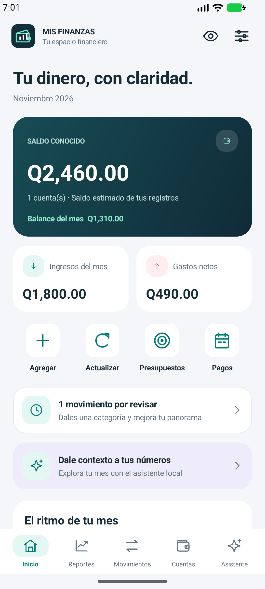
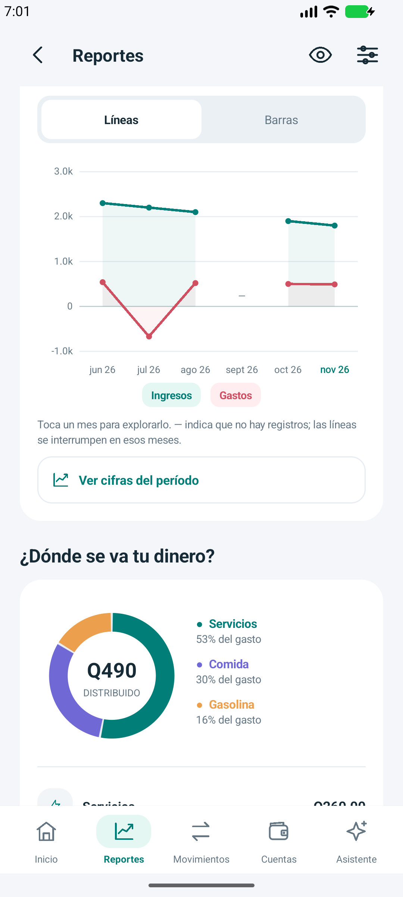
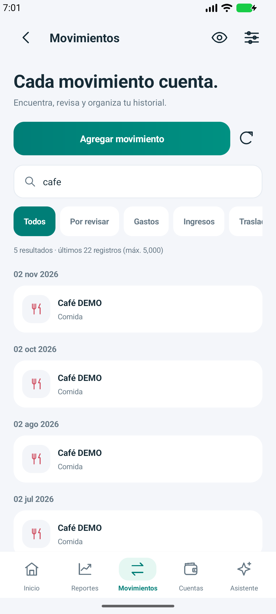
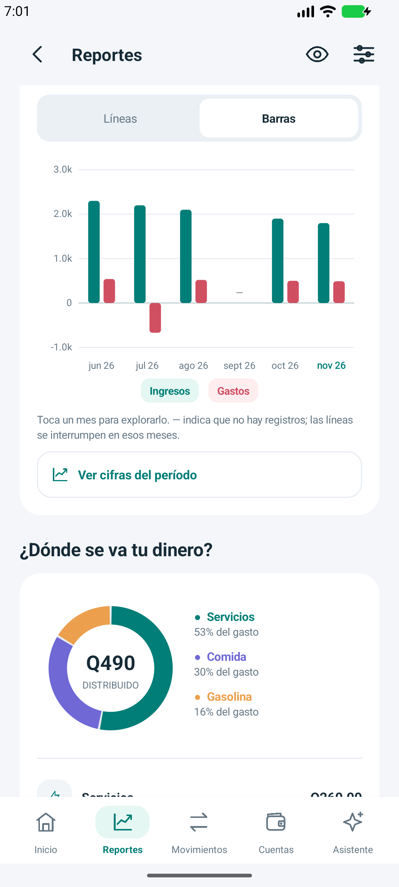
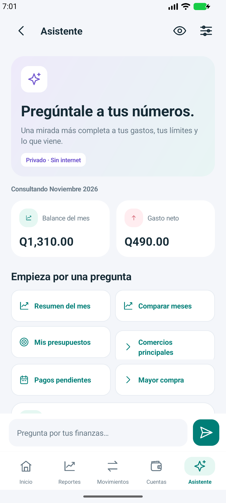
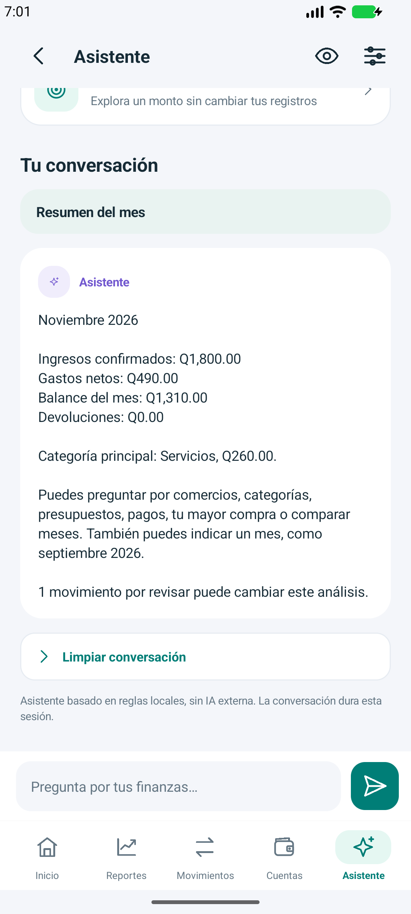

# Mis Finanzas Privadas

Aplicación Android para registrar y comprender las finanzas personales en quetzales. Desarrollada en Kotlin, con interfaz nativa y almacenamiento SQLite local. **Funciona sin conexión bancaria y no tiene permiso de Internet.**

Este repositorio contiene el código del proyecto, documentación y pruebas con datos inventados. No contiene datos del teléfono, respaldos, credenciales ni claves de firma.

## Qué permite hacer

- Consultar cuentas y saldos estimados a partir de un saldo real registrado.
- Agregar gastos e ingresos manuales o importar alertas SMS compatibles de Banrural y Banco Industrial, con permiso opcional.
- Separar gastos, ingresos confirmados, devoluciones, pendientes y transferencias internas.
- Explorar ingresos y gastos en períodos de 3, 6 o 12 meses, con líneas, barras y distribución por categoría.
- Buscar movimientos y filtrar pendientes para clasificarlos.
- Gestionar presupuestos, pagos recurrentes y recordatorios locales.
- Exportar reportes CSV y guardar/restaurar copias JSON mediante acciones explícitas.
- Conversar con un asistente local sobre meses, categorías, comercios, presupuestos y pagos, sin IA externa.
- Simular un monto de ahorro sin modificar cuentas ni movimientos.

## Actualización 0.5.0

Rediseño de la identidad visual: marca vectorial, iconos consistentes, tarjetas de saldo e indicadores, accesos rápidos, navegación renovada y formularios desplazables. El botón del ojo permite ocultar montos y gráficas.

Reportes con líneas o barras, selección de 3/6/12 meses, dona por categorías, gasto acumulado diario y comercios principales. Los meses sin registros y los valores negativos por devoluciones se representan explícitamente.

Asistente accesible desde la navegación principal, con preguntas sugeridas, conversación durante la sesión y campo de consulta fijo. Reconoce meses escritos en español o como `2026-09`, compara registros, consulta límites y permite simular un ahorro. **Es un motor local basado en reglas, no IA generativa.** No envía datos a servicios externos.

Se mantiene `gt.finanzas.privadas`, `mis_finanzas.db`, esquema SQLite 1 y el formato de respaldo. La versión aumenta a `versionCode = 7`.

**Para actualizar una app existente, primero guarda un respaldo privado y usa la misma firma. No desinstales la versión anterior.** Consulta la [guía de actualización](docs/ACTUALIZACION.md).

## Capturas

Las capturas de verificación se generan exclusivamente en un emulador con datos ficticios. No deben publicarse capturas del teléfono con información real.

| Inicio | Evolución mensual | Búsqueda |
| --- | --- | --- |
|  |  |  |

[Ver pantalla con montos ocultos](docs/screenshots/privacy.png).

| Distribución por categorías | Asistente local | Conversación |
| --- | --- | --- |
|  |  |  |

## Desarrollo

- Android Studio, Android SDK Platform 35 y JDK 17 o 21.
- Android mínimo 8.0 (API 26); target SDK 35.
- Android Gradle Plugin 8.7.3, Kotlin 2.0.21 y Gradle Wrapper 8.9.
- Configura el SDK en Android Studio o en tu `local.properties`, que no se versiona.

En Windows:

```powershell
.\gradlew.bat :app:assembleDebug :app:testDebugUnitTest :app:lintDebug
```

En Linux/macOS:

```sh
./gradlew :app:assembleDebug :app:testDebugUnitTest :app:lintDebug
```

APK local: `app/build/outputs/apk/debug/app-debug.apk`. No se incluye en Git ni se comparte la clave de firma. La compilación requiere descargar herramientas y dependencias; la app instalada funciona sin Internet.

## Estructura

| Archivo | Función |
| --- | --- |
| `MainActivity.kt` | Interfaz, navegación y acciones explícitas |
| `FinanceCharts.kt` | Gráfica local con escala y valores negativos |
| `ReportMath.kt` | Cálculos de presentación verificables |
| `FinanceDesign.kt` | Paleta e iconos vectoriales compartidos |
| `FinanceReadModel.kt` | Consultas de reportes de solo lectura sin límite de filas de la lista |
| `FinanceAnalysis.kt` | Meses de consulta y gasto acumulado diario |
| `FinanceDb.kt` | SQLite, movimientos, reportes y respaldo |
| `BankParser.kt` | Reglas de reconocimiento de alertas bancarias |
| `BankNotificationListener.kt` | Importación opcional de notificaciones compatibles |
| `Reminders.kt` | Recordatorios locales |

Código principal en `app/src/main/java/gt/finanzas/privadas/`.

Las pruebas unitarias comprueban formatos sintéticos de SMS, descarte de mensajes sensibles y cálculos de presentación. La [prueba de actualización](docs/PRUEBAS.md) usa exclusivamente un emulador vacío y verifica conservación de datos y navegación.

## Límites y privacidad

Los SMS pueden faltar o llegar duplicados. Los saldos son estimaciones; compáralos con tu banco. Los pendientes y traslados internos no se contabilizan como consumo confirmado.

La base de datos no está cifrada por la app. Los respaldos JSON y reportes CSV son privados y no cifrados. **Ocultar Q** solo protege la visualización; no cifra archivos ni oculta nombres. Lee las [notas de privacidad](docs/PRIVACIDAD.md) antes de compartir información.

Consulta el [historial de cambios](CHANGELOG.md).
